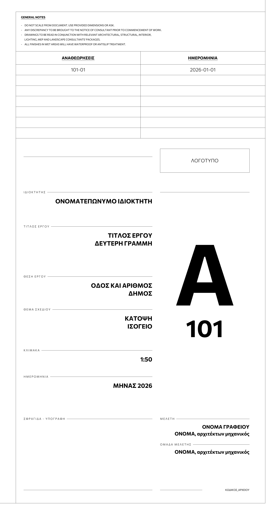
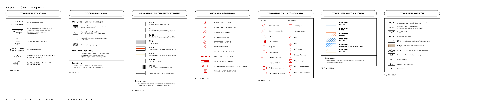
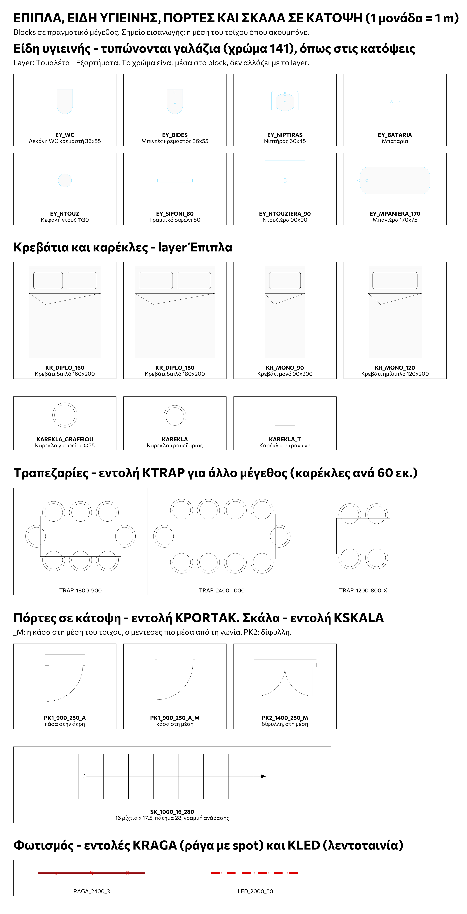

# cad-kit

A CAD template kit for architectural drawings, with the metre as drawing unit,
and the generator that builds it.







## What is in the kit

- `out/KIT.dxf`: layers, text styles, dimension styles and 277 blocks, laid out
  in model space.
  - Tags and symbols, electrical and lighting symbols, 7 legends, title block,
    revision table, general notes, sheet frames A0 to A3. Each at 1:25, 1:50
    and 1:100.
  - Sample sliding frames, windows, a door in elevation, a suspended ceiling in
    section, doors in plan, a stair, dining tables.
  - Sanitary fixtures (light blue, as in the reference plans), beds, chairs.
  - Socket height arrows in four directions.
  - A palette of loose objects for copy or MATCHPROP: room names at 1:25 to
    1:200, dimension samples, skirting lines, hatch samples.
- `out/ctb/KIT-25.ctb`, `KIT-50.ctb`, `KIT-100.ctb`: the same colours, pen
  widths per scale. Electrical layers plot red.
- `lisp/KIT.lsp`: commands that draw at the size you pick: sliding frames,
  windows, doors, ceiling, stair, dining table, lighting track, LED tape
  (`KSYR`, `KSYRM`, `KSYRX`, `KPAR`, `KPORTA`, `KPORTAK`, `KPSEYD`, `KSKALA`,
  `KTRAP`, `KRAGA`, `KLED`, `KSYND`), and hatch commands for floors, wood and
  ceilings (`KDAP`, `KXYLO`, `KOROFI`).
- `out/fonts`: Commissioner in four static weights (SIL Open Font License).
- `out/ODIGIES.md`: the user guide, in Greek.
- `out/preview`: pictures of the content.

`KIT.dwg` is not in the repository. Open `KIT.dxf` in the CAD program and save
it as DWG, or build the DWG with `gen/convert.sh`.

## State

Nothing here has run in AutoCAD, ZWCAD or BricsCAD yet. The DXF passes the
ezdxf audit, the DWG round trip through the ODA File Converter is identical,
and `KIT.lsp` runs in the interpreter in `gen/minilisp.py`; 84 tests in all.
The DWG round trip was not repeated after the second round of additions.

To continue the work, read `docs/HANDOFF.md` and `AGENTS.md`.

## Build

```sh
python -m venv .venv && .venv/bin/pip install ezdxf fonttools matplotlib skia-pathops
.venv/bin/python gen/build.py          # out/KIT.dxf, out/ctb/*.ctb
.venv/bin/python gen/docs.py           # out/ODIGIES.md
.venv/bin/python gen/preview.py        # out/preview/*.png
cd gen && ../.venv/bin/python -m unittest test_lisp test_build
ODA_CONVERTER=/path/to/ODAFileConverter gen/convert.sh   # out/KIT.dwg
.venv/bin/python gen/check_dwg.py      # DWG round-trip check
```

## Layout

- `lisp/KIT.lsp`: the parametric blocks, in AutoLISP with `entmake`. ASCII
  only. It is the single source for those blocks: `gen/minilisp.py` runs it and
  `gen/build.py` copies the result into the DXF.
- `gen/symbols.py`: annotation symbols, legends, title block, in paper mm.
- `gen/draw.py`: drawing helper that scales paper mm to drawing units.
- `gen/build.py`: layers, pens, blocks, library sheet, CTB writer.
- `gen/docs.py`: writes the user guide from the build tables.
- `gen/make_fonts.py`: makes the static fonts from the variable font.
